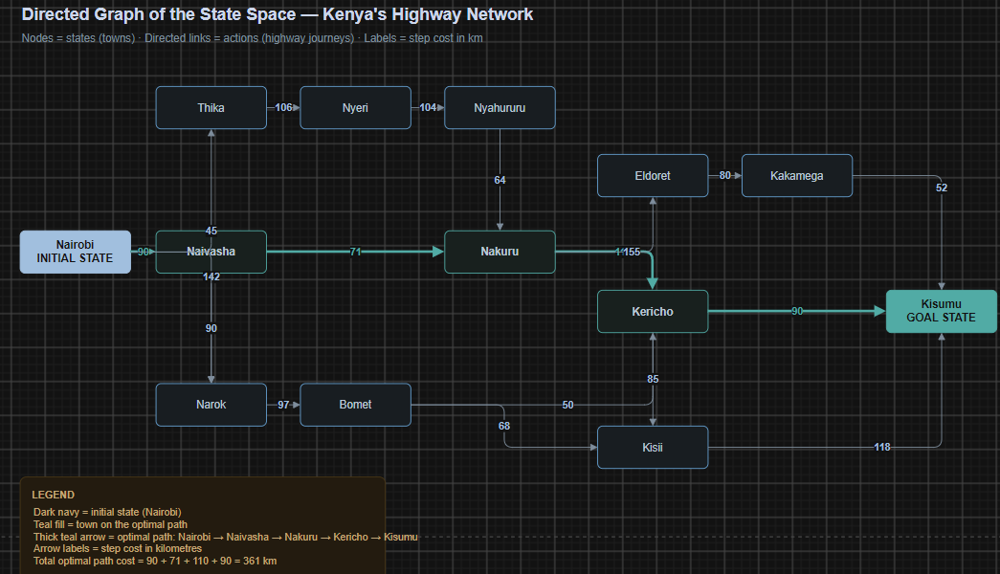
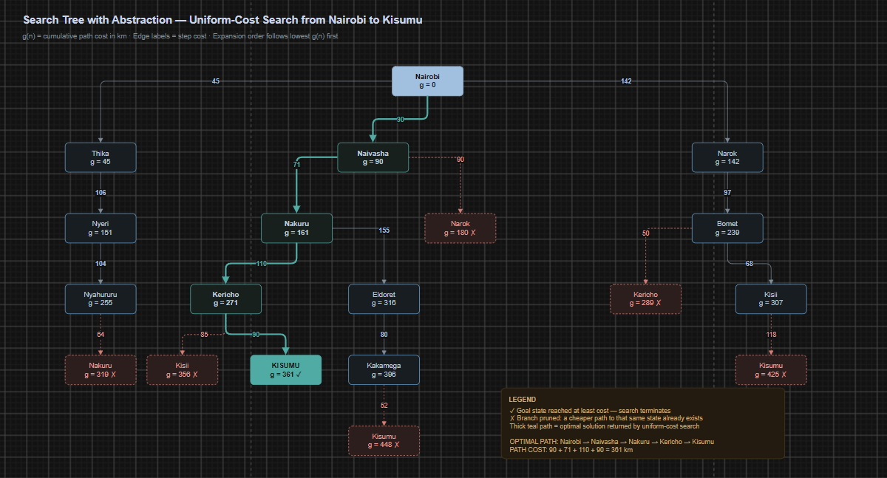

# Designing a Searching Agent — Self-Driving Trailer

**ICS 3202: Artificial Intelligence — Practical Exercise 3**
*

**Problem:** A self-driving trailer must travel from **Nairobi** to **Kisumu** across Kenya's highway network at the lowest possible path cost.

**Group members**
Austine Igunza -166990
Paul Kiragu - 190135
Mwijukye Chief Cedrick - 192468
---

## 1. Agent Design

### 1.1 PEAS Framework

| Element | Specification for the self-driving trailer |
|---|---|
| **Performance measure** | Cargo delivered safely and undamaged; shortest total distance travelled (km) from Nairobi to Kisumu; least trip time; fuel efficiency; zero traffic-law violations; zero collisions with other road users; axle load within weighbridge limits |
| **Environment** | Kenya's highway network (A104 Nairobi–Nakuru–Eldoret, B1 Nakuru–Kericho–Kisumu, B3 Nairobi–Narok, A2 Nairobi–Thika–Nyeri); towns and junctions; other vehicles; pedestrians, cyclists and livestock; traffic law and road signage; weighbridges and police checkpoints; weather; road surface condition; fuel stations |
| **Actuators** | Steering wheel; accelerator; brake; gear/transmission system; indicators; headlights; horn |
| **Sensors** | GPS receiver; cameras; LiDAR / sonar radar; speedometer; odometer; fuel gauge; axle-load sensors; tyre-pressure sensors |

**Note on P:** the performance measure is **distance in kilometres**, because the path cost function in Section 3 must reflect the performance measure (Problem Formulation, factor 4).

### 1.2 Environment Definitions

| Dimension | Classification | Justification |
|---|---|---|
| **Observability** | **Partially observable** | Sensors only perceive the immediate surroundings. The trailer cannot see road conditions, accidents or traffic further down the A104 until it arrives, so it must make informed guesses about the state of the world ahead. |
| **Determinism** | **Stochastic** | Many aspects lie beyond the agent's control, other drivers' behaviour, weather on the Mau escarpment, unmarked road works, livestock crossing. The same action in the same state does not guarantee the same resulting state. |
| **Episodic / Sequential** | **Sequential** | Every choice constrains the next. Turning towards Narok at Mai Mahiu removes Nakuru and Kericho from reach without backtracking, so the current action depends on all previous actions. |
| **Static / Dynamic** | **Dynamic** | The highway changes while the agent is deliberating, vehicles move, lights change, traffic builds. The trailer must consult the environment again before committing to an action. |
| **Agents** | **Multi-agent** | The trailer shares the highway with other drivers, pedestrians and cyclists, each acting on their own performance measure. Some are competitive (lane and overtaking contests), some co-operative (yielding at junctions). |

---

## 2. State Space: Directed Graph and Search Tree

### 2.1 Applying Abstraction

Abstraction means **leaving out irrelevant information**  keeping only the states and actions that contribute to solving the search problem.

| Abstracted away | Reason |
|---|---|
| Individual roads, bends, lanes and junctions within a town | Irrelevant to choosing a route between towns |
| Low-level actions (`steer left`, `brake`, `accelerate`, `change gear`) | Collapsed into one action: **`travel(Town A → Town B)`** |
| Towns leading away from the goal (Nanyuki, Embu, Meru, Garissa, Namanga) | Cannot lie on any shortest Nairobi→Kisumu path |
| Northern Rift (Kitale, Kapenguria) and far western border (Busia, Malaba) | Lie beyond Kisumu, expanding them only increases path cost |
| Fuel stops, weighbridges, rest breaks | Do not change which town the agent is in |

**Result:** a state = *the town the trailer is currently in*. An action = *travelling the highway link to an adjacent town*.

### 2.2 Towns in the State Space

| Code | Town | Region |
|---|---|---|
| NBO | Nairobi | Nairobi |
| THK | Thika | Central Highlands |
| NYR | Nyeri | Central Highlands |
| NYH | Nyahururu | Central Highlands |
| NVS | Naivasha | Rift Valley |
| NRK | Narok | Rift Valley |
| NKU | Nakuru | Rift Valley |
| BMT | Bomet | Rift Valley |
| KRC | Kericho | Rift Valley |
| ELD | Eldoret | Rift Valley |
| KSI | Kisii | Lake Victoria Basin |
| KKG | Kakamega | Lake Victoria Basin |
| KSM | Kisumu | Lake Victoria Basin |

### 2.3 Directed Graph of the State Space

Nodes are **states** (towns); links are **actions** (highway journeys), labelled with their **step cost in kilometres**. Edges are directed in the direction of travel towards the goal,  a second abstraction, since a shortest path to Kisumu never requires driving back east.




### 2.4 Adjacency / Step Cost Table

| From | To | Highway | Step cost (km) |
|---|---|---|---|
| Nairobi | Thika | A2 | 45 |
| Nairobi | Naivasha | A104 | 90 |
| Nairobi | Narok | B3 (via Mai Mahiu) | 142 |
| Thika | Nyeri | A2 | 106 |
| Nyeri | Nyahururu | B5 | 104 |
| Nyahururu | Nakuru | B5 | 64 |
| Naivasha | Nakuru | A104 | 71 |
| Naivasha | Narok | B3 | 90 |
| Narok | Bomet | B3 | 97 |
| Nakuru | Kericho | B1 | 110 |
| Nakuru | Eldoret | A104 | 155 |
| Bomet | Kericho | C23 | 50 |
| Bomet | Kisii | B3 | 68 |
| Kericho | Kisumu | B1 | 90 |
| Kericho | Kisii | C23 | 85 |
| Kisii | Kisumu | B1 | 118 |
| Eldoret | Kakamega | A104/B2 | 80 |
| Kakamega | Kisumu | B2 | 52 |

> Distances taken from Google Maps road measurements between town centres. Nairobi–Nakuru (90 + 71 = 161 km), Nairobi–Nyeri (45 + 106 = 151 km), Nyeri–Nyahururu (104 km) and Nyahururu–Nakuru (64 km) agree with the figures used in the lecture worked example.

### 2.5 Search Tree

The tree starts at the **initial state** (root) and branches out through actions to other states within the state space. Nodes are shown with their **cumulative path cost g(n)** in kilometres.



## 3. Determining the Optimal Path

### 3.1 Path Cost Function

```
g(n) = Σ (step costs of all individual actions along the path)
```

where each step cost is the **road distance in kilometres** between two adjacent towns. This reflects the agent's performance measure (shortest total distance).

**Goal test:** *is the trailer's current state Kisumu?*

### 3.2 Search Strategy

**Uniform-cost search** (Dijkstra's algorithm) — always expand the frontier node with the lowest g(n). This guarantees the optimal (least-cost) solution when all step costs are positive, which holds here since every step cost is a distance greater than zero.

### 3.3 Search Trace

| Step | Node expanded | g(n) | Frontier after expansion (ordered by g) |
|---|---|---|---|
| 1 | Nairobi | 0 | Thika 45, Naivasha 90, Narok 142 |
| 2 | Thika | 45 | Naivasha 90, Narok 142, Nyeri 151 |
| 3 | Naivasha | 90 | Narok 142, Nyeri 151, Nakuru 161 *(Narok 180 discarded)* |
| 4 | Narok | 142 | Nyeri 151, Nakuru 161, Bomet 239 |
| 5 | Nyeri | 151 | Nakuru 161, Bomet 239, Nyahururu 255 |
| 6 | **Nakuru** | **161** | Bomet 239, Nyahururu 255, Kericho 271, Eldoret 316 |
| 7 | Bomet | 239 | Nyahururu 255, Kericho 271, Kisii 307, Eldoret 316 *(Kericho 289 discarded)* |
| 8 | Nyahururu | 255 | Kericho 271, Kisii 307, Eldoret 316 *(Nakuru 319 discarded)* |
| 9 | **Kericho** | **271** | Kisii 307, Eldoret 316, Kisumu 361 *(Kisii 356 discarded)* |
| 10 | Kisii | 307 | Eldoret 316, Kisumu 361 *(Kisumu 425 discarded)* |
| 11 | Eldoret | 316 | Kisumu 361, Kakamega 396 |
| 12 | **Kisumu** | **361** | **GOAL TEST PASSED — search terminates** |

### 3.4 Comparison of Candidate Routes

| Route | Path | Total cost (km) |
|---|---|---|
| **1 — A104 / B1 corridor** | **Nairobi → Naivasha → Nakuru → Kericho → Kisumu** | **361**  |
| 2 — Narok / Bomet | Nairobi → Narok → Bomet → Kericho → Kisumu | 379 |
| 3 — Narok / Kisii | Nairobi → Narok → Bomet → Kisii → Kisumu | 425 |
| 4 — Northern A104 | Nairobi → Naivasha → Nakuru → Eldoret → Kakamega → Kisumu | 448 |
| 5 — Central Highlands | Nairobi → Thika → Nyeri → Nyahururu → Nakuru → Kericho → Kisumu | 519 |

### 3.5 Optimal Solution

> ### Nairobi → Naivasha → Nakuru → Kericho → Kisumu
> ### Total path cost = 90 + 71 + 110 + 90 = **361 km**

**Step 4 — Execute:** the trailer carries out this sequence of actions, travelling the A104 from Nairobi through Naivasha to Nakuru, then the B1 through Kericho to Kisumu. It is the optimal solution because it has the **least path cost** of all paths from the initial state to the goal state.

**Why the alternatives lose:**
- Route 2 and 3 (Narok) — the B3 swings south-west through Narok and Bomet, adding distance before rejoining the corridor.
- Route 4 (Eldoret) — the A104 continues north-west past the Kisumu turn-off, so Kakamega is a detour.
- Route 5 (Central Highlands) — the A2/B5 loop north through Nyeri and Nyahururu before reaching Nakuru, repeating the lecture's point that the longer Nyeri route should be abstracted out.

---

## 4. Evidence of Groupwork

### 4.1 Team Photograph


ALL MEMEBERS PRESENT DURING THE GOOGLE MEET


