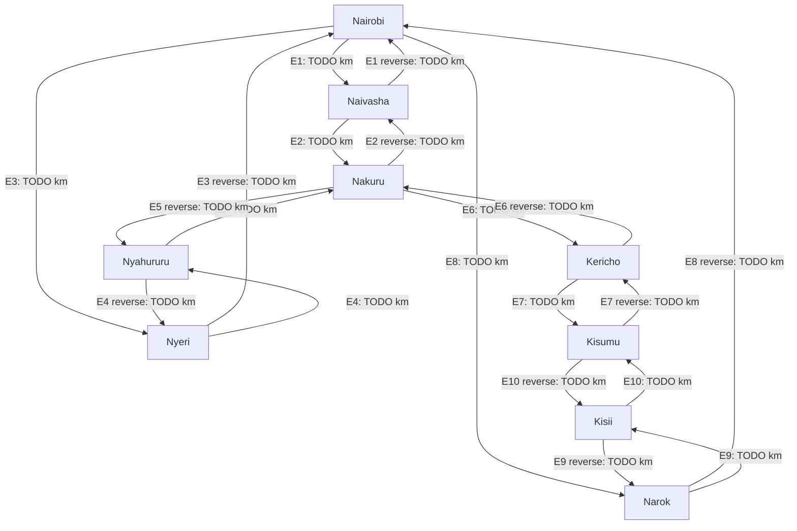
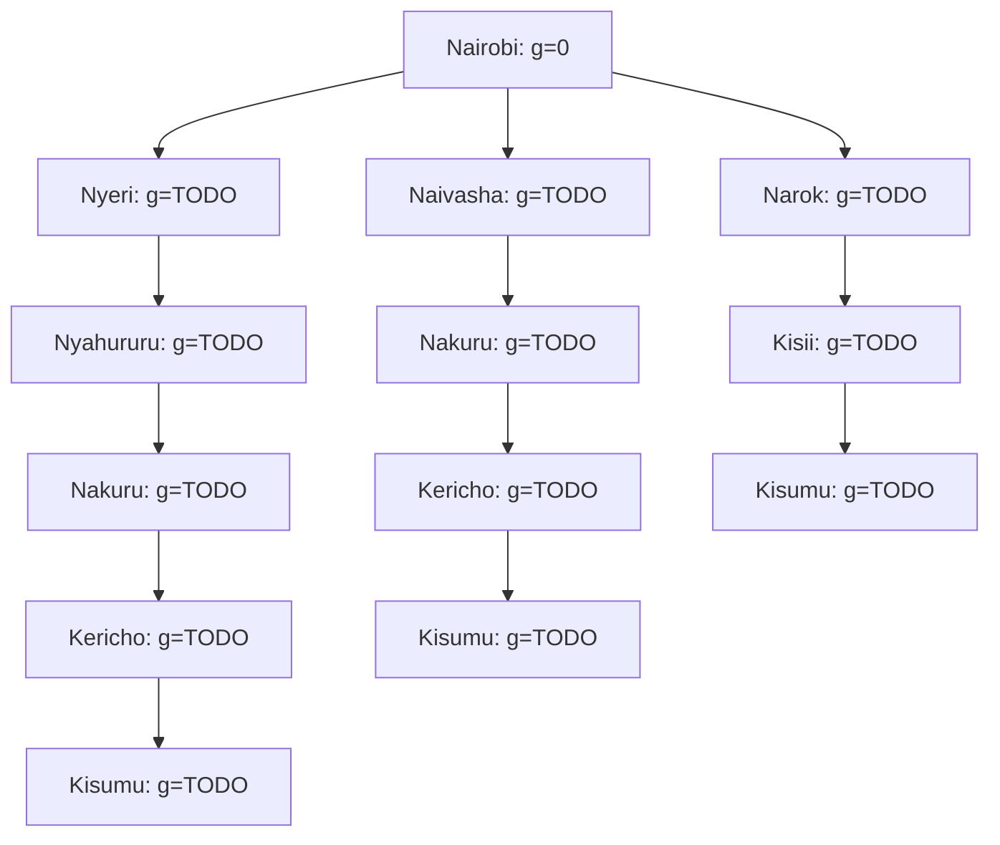

# ICS 3202: Artificial Intelligence
# Practical Exercise 3: Designing a Searching Agent

**Group:16**  

IGUNZA AUSTINE -166990
CHIEF MWIJUKYE -192468
PAUL KIRAGU -190135

# 1. Agent design

The agent is a self-driving trailer transporting cargo from Nairobi to Kisumu. Its route planner seeks a feasible route with minimum total road distance. Safe and legal operation remains a constraint on its execution.

### 1.1 PEAS framework 
Component: Application to the self-driving trailer 

1. Performance measure - Minimise total distance from Nairobi to Kisumu while arriving safely, obeying traffic rules, preserving cargo and respecting vehicle constraints. 
2. Environment - Kenya's highway network; towns, junctions, road surfaces, other vehicles, pedestrians, weather, traffic signals and destination/loading facilities. 
3. Actuators - Steering, accelerator, brakes, transmission, indicators, horn and lights. 
4. Sensors - GPS, cameras, radar/lidar where fitted, speed and wheel sensors, inertial sensors and vehicle-status sensors; digital maps provide stored road information. 

### 1.2 Five environment dimensions

| Dimension | Actual driving environment | Justification |
| --- | --- | --- |
| Observability | Partially observable | Sensors cannot reveal every hazard, other drivers' intentions or all conditions beyond their range. |
| Determinism | Stochastic | Other road users and changing conditions make action outcomes uncertain. |
| Episodic/sequential | Sequential | Earlier choices affect later location, available routes and driving decisions. |
| Static/dynamic | Dynamic | Vehicles, pedestrians and road conditions can change while the agent decides. |
| Discrete/continuous | Continuous, with discrete planning states | Position, time, speed and steering vary continuously; the route planner abstracts location into towns. |

Route-planning assumptions: We use a fully known, static, deterministic, discrete graph during one search. Each edge has a fixed positive distance. Road feasibility for the trailer is TODO: state the assumption or verification. These assumptions simplify planning without changing the classification of actual driving.

## 2. Directed graph and search tree

### 2.1 Problem formulation and abstraction

| Item | Definition |
| --- | --- |
| Initial state | Nairobi |
| State space | Towns in the verified graph below |
| Actions | Travel along a permitted directed road link to an adjacent town |
| Transition model | Following an edge from town u to town v changes the planning state to v |
| Goal test | Current town = Kisumu |
| Step cost | Recorded driving distance in kilometres for an edge |
| Path cost | Sum of edge distances along the selected route |

We retain towns, their highway connections, permitted direction and road distance. We omit individual bends, minor settlements, buildings and lane-level control. Smaller settlements may occur within an abstract edge. We do not omit competing routes solely because they appear longer before evaluating their costs.

Map/reference used: https://www.google.com/maps/@-0.6429168,35.8398069,9.06z?entry=ttu&g_ep=EgoyMDI0MDgyOC4wIKXMDSoASAFQAw%3D%3D

| Region | Selected towns — verify against class map |
| --- | --- |
| Nairobi | Nairobi |
| Central Highlands | Nyeri, Nyahururu |
| Rift Valley | Naivasha, Nakuru, Narok, Kericho |
| Lake Victoria Basin | Kisii, Kisumu |

### 2.2 Edge distances and measurement evidence

The connections below are proposed examples to verify. Add missing connections and remove unsupported ones before searching. Each row currently denotes two directed edges with a shared cost under a symmetric-distance assumption; if not using that assumption, create separate forward and reverse rows and update the diagram.

Use consistent town endpoints and record the selected road corridor, not just town names.

| Edge ID | From | To | Distance (km) | Selected road/via points and endpoints | Google Maps directions link | Date accessed |
| --- | --- | --- | --- | --- | --- | --- |
| E1 | Nairobi | Naivasha | TODO | TODO | TODO | TODO |
| E2 | Naivasha | Nakuru | TODO | TODO | TODO | TODO |
| E3 | Nairobi | Nyeri | TODO | TODO | TODO | TODO |
| E4 | Nyeri | Nyahururu | TODO | TODO | TODO | TODO |
| E5 | Nyahururu | Nakuru | TODO | TODO | TODO | TODO |
| E6 | Nakuru | Kericho | TODO | TODO | TODO | TODO |
| E7 | Kericho | Kisumu | TODO | TODO | TODO | TODO |
| E8 | Nairobi | Narok | TODO | TODO | TODO | TODO |
| E9 | Narok | Kisii | TODO | TODO | TODO | TODO |
| E10 | Kisii | Kisumu | TODO | TODO | TODO | TODO |

### 2.3 Directed graph

Replace each `TODO` with the measured kilometres. Two arrows explicitly model travel in both directions. If reverse costs differ, label both arrows separately.

### 2.4 Abstract search tree

This starter shows selected route histories only. It is a partial tree, not the completed uniform-cost expansion trace. Repeated towns have separate node IDs because they represent different paths. Immediate returns to ancestors are omitted because positive-cost cycles cannot improve a route. Other legal branches must be added or their pruning explained using actual best-known costs.

**Final tree scope and pruning explanation:** TODO: extend the tree or state every omitted branch category and justify it. Cumulative cost g is the sum from Nairobi to that tree node.

## 3. Optimal path from Nairobi to Kisumu

### 3.1 Search method

We use uniform-cost graph search with positive edge distances. The frontier is ordered by cumulative path cost g. We retain the least known cost and predecessor for each town, update them when a cheaper path is found, and discard stale higher-cost entries. Equal-cost ties are broken alphabetically. We stop when Kisumu is removed as the minimum-cost frontier entry, not when it is first generated.

### 3.2 Search trace

Add one row per actual expansion. The initial frontier is `{Nairobi: 0}`. Show each updated frontier in increasing cost order, using `Town: cumulative_km`.

| Step | Town removed | g (km) | Neighbour updates and predecessor changes | Frontier after expansion |
| --- | --- | --- | --- | --- |
| 1 | Nairobi | 0 | TODO | TODO |
| TODO | TODO | TODO | TODO | TODO |

### 3.3 Supporting route calculations

These are candidate routes from the example network, not a proof that no other modelled route is cheaper. Update them to match the verified graph and show numerical addition.

| Candidate | Route | Segment calculation (km) | Total (km) |
| --- | --- | --- | --- |
| A | Nairobi → Naivasha → Nakuru → Kericho → Kisumu | E1 + E2 + E6 + E7 = TODO | TODO |
| B | Nairobi → Nyeri → Nyahururu → Nakuru → Kericho → Kisumu | E3 + E4 + E5 + E6 + E7 = TODO | TODO |
| C | Nairobi → Narok → Kisii → Kisumu | E8 + E9 + E10 = TODO | TODO |

### 3.4 Result and justification

**Selected route:** TODO  
**Distance calculation:** TODO + TODO + … = TODO km.

Kisumu was removed from the frontier with cumulative cost TODO km. At that point no remaining frontier entry had a lower cost. Because all step costs are positive and uniform-cost search always expands the cheapest frontier path, this is the shortest route within our modelled network and recorded distances. The result does not establish the shortest route over roads omitted from our abstraction.

## 4. Evidence of groupwork

### 4.1 Meeting minutes

Record a real meeting; duplicate this section if necessary.

**Date and time:** TODO  
**Location/platform:** TODO  
**Attendees:** TODO  
**Apologies/absent members:** TODO  
**Chair and minute taker:** TODO

| Agenda | Discussion | Decision | Responsible member |
| --- | --- | --- | --- |
| PEAS and environment | TODO | TODO | TODO |
| Towns, roads and abstraction | TODO | TODO | TODO |
| Google Maps distances | TODO | TODO | TODO |
| Search and optimal route | TODO | TODO | TODO |
| GitHub review and submission | TODO | TODO | TODO |

**Completed actions and review confirmation:** TODO: record actual work, dates and who checked it.

### 4.2 Fork and contribution evidence

Add rows for all members. For the original owner, identify their owner role and link their commits rather than inventing a same-account fork.

| Member | Fork URL or original-owner role | Contribution/commit link | Pull request link where applicable |
| --- | --- | --- | --- |
| TODO | TODO | TODO | TODO |
| TODO | TODO | TODO | TODO |

### 4.3 Optional group photo

If using a photo, upload the actual image to `images/team-photo.jpg`, then replace this paragraph with `` and identify the participants. Remove this optional section if using minutes alone.

## 5. References

1. Practical Exercise 3 assignment instructions, ICS 3202, August–November 2026.
2. Allan Vikiru, *Problem Solving Agents*, supplied class slides. The slides carry the label BBT 3201; this submission follows the assignment's ICS 3202 label.
3. Class highway map/reference: TODO.
4. Google Maps driving-distance sources and access dates: see edge measurement table.
